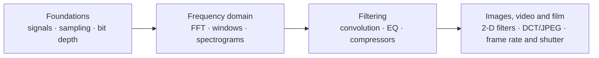

# Signal Processing Primer

A Mac app that teaches signal processing for audio, images, video and film. It has 12 lessons, and each one has a demo you can play with and listen to, plus a short quiz.

| Spectrograms | Filter design | Image kernels |
|---|---|---|
|  |  |  |
| **Compression (DCT)** | **Compressor** | **Frame rate and shutter** |
|  |  |  |

**Links:** [Setup and use](docs/INSTRUCTIONS.md) · [System design](docs/SYSTEM-DESIGN.md) · [File structure](docs/FILE-STRUCTURE.md) · [Original brief](signal_processing_primer.md)
