# Signal Processing Primer

A course on signal processing for audio, images, video and film, as a Mac app and a website. It has 13 lessons, and each one has a demo you can play with and listen to, plus a short quiz.

**Website:** [claude.ai/artifact/4mZjs9pvjHnj2D5RcxiPtu](https://claude.ai/artifact/4mZjs9pvjHnj2D5RcxiPtu) (private until you share it)

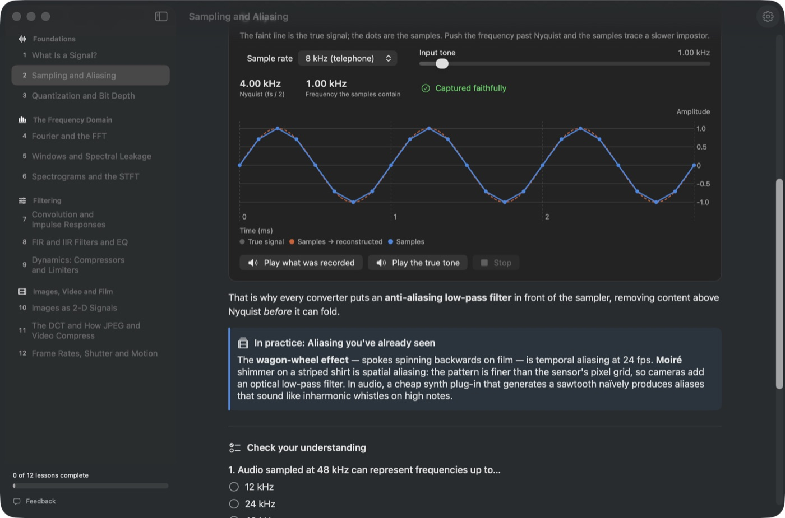

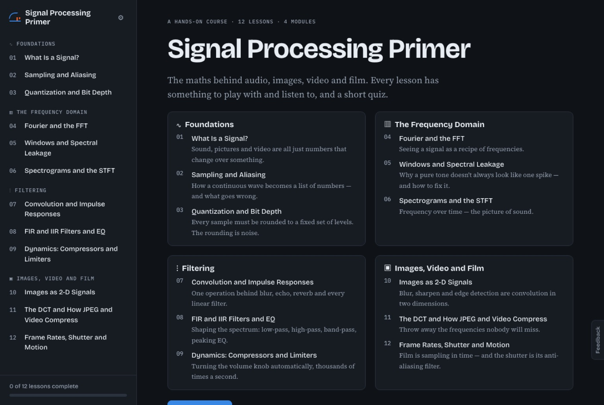

| Spectrograms | Filter design | Image kernels |
|---|---|---|
| 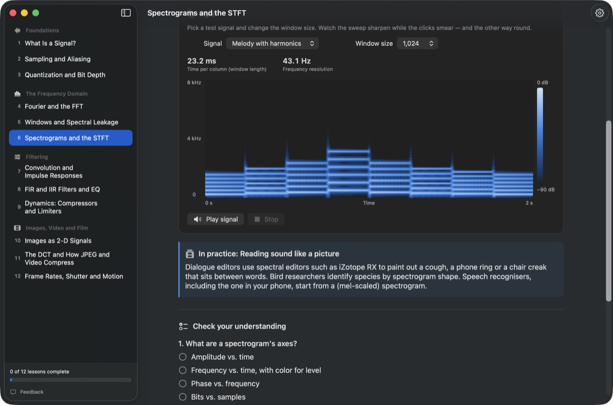 | 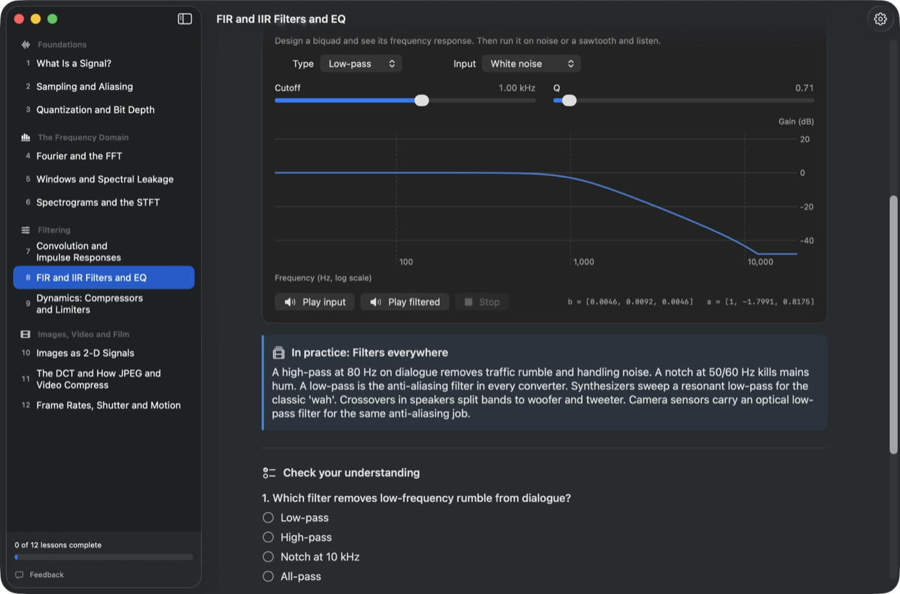 | 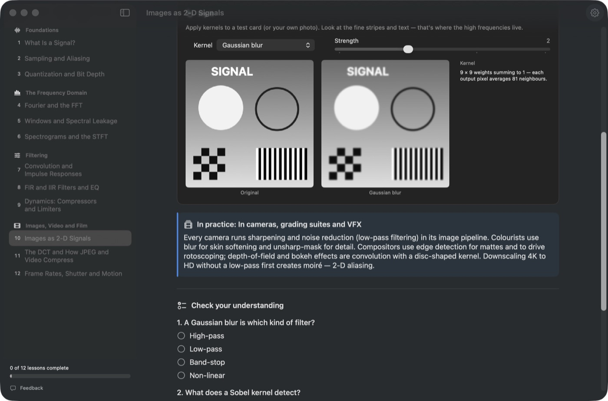 |
| **Compression (DCT)** | **Compressor** | **Frame rate and shutter** |
| 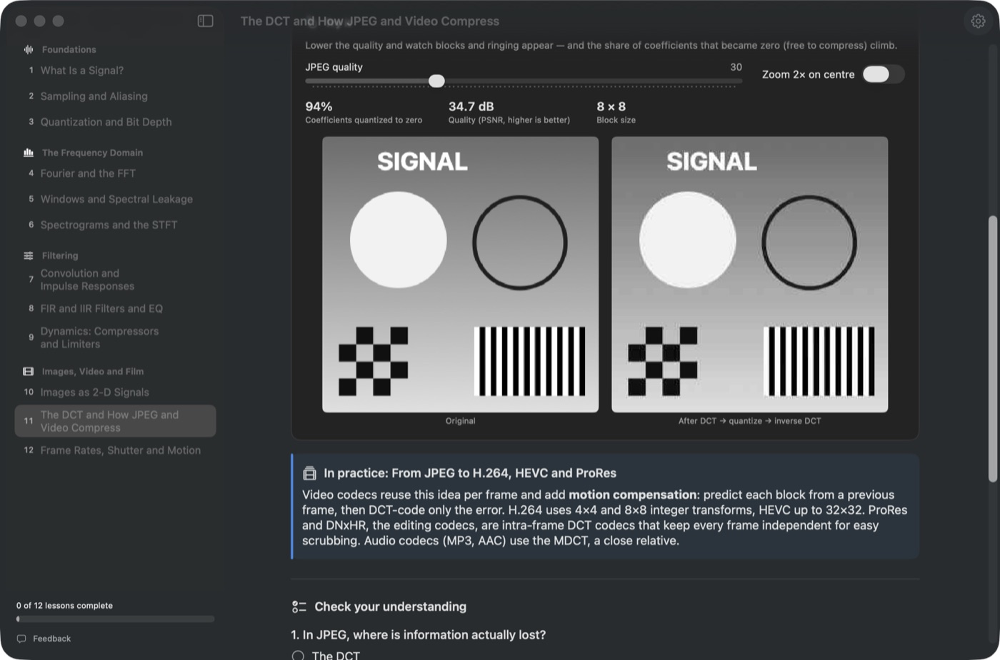 | 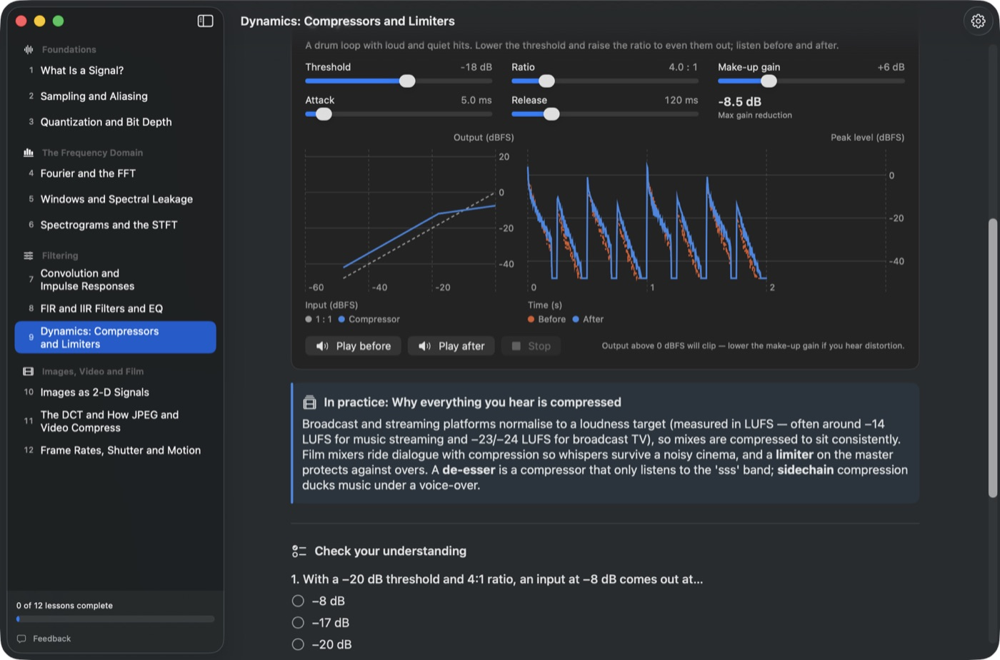 | 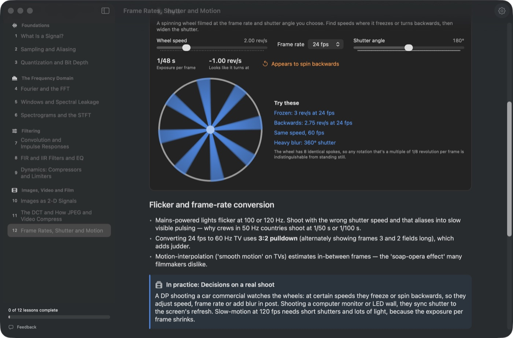 |
| **Colour, gamma and white balance** | **Colour gamuts** | |
| 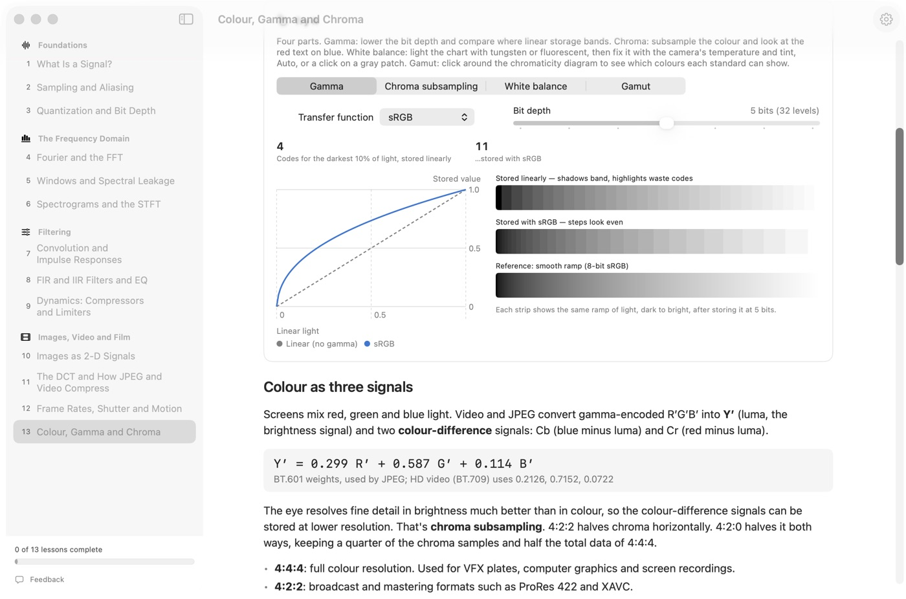 | 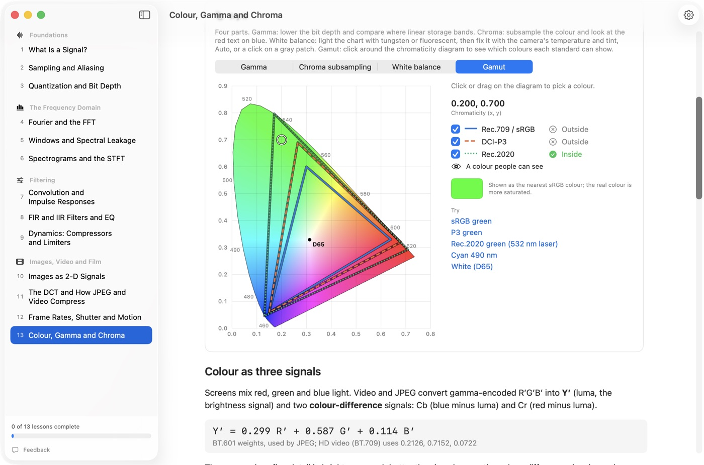 | |

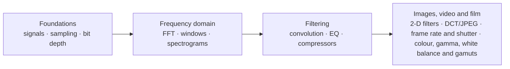

**Links:** [Website](https://claude.ai/artifact/4mZjs9pvjHnj2D5RcxiPtu) · [Setup and use](docs/INSTRUCTIONS.md) · [System design](docs/SYSTEM-DESIGN.md) · [File structure](docs/FILE-STRUCTURE.md) · [Original brief](signal_processing_primer.md)
