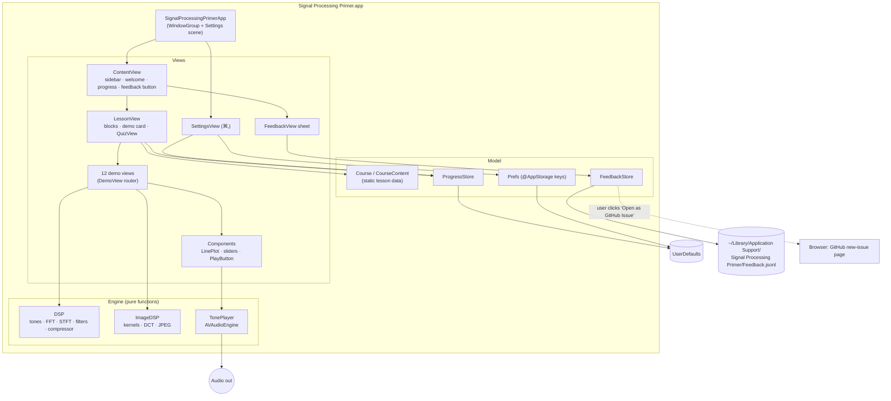

# System Design

Signal Processing Primer is a single-window native macOS app (SwiftUI, macOS 14+). It has no server, no network calls and no third-party dependencies. Everything it needs is in the app bundle, and the course content is compiled in as Swift data.

## Architecture

## Components

| Component | Job |
|---|---|
| `SignalProcessingPrimerApp` | Creates the main window and the standard `Settings` scene, which gives ⌘, and the app-menu item. Adds Help ▸ Send Feedback… (⇧⌘F). |
| `ContentView` | `NavigationSplitView` with the course sidebar (module sections, completion ticks, progress bar and a small Feedback button) and the detail pane. The toolbar gear opens Settings. Stops any sound when you switch lessons. |
| `LessonView` / `QuizView` | Renders a lesson's `Block`s in order: text with inline Markdown, headings, formula cards, bullets, *In practice* boxes and the demo card. Then the quiz, which scores your answers, shows explanations and records progress. |
| Demo views | One view per `DemoKind`. Each keeps its own `@State` parameters, calls the engine to compute plots and sounds, and redraws on every change. The heavy image work runs in a detached task. |
| `Components` | Shared building blocks: the validated colour palette, `ParamSlider`, `PlayButton`/`StopButton`, `Readout`, `DemoCard` and `LinePlot`. `LinePlot` is a Swift Charts line chart with a legend only when there are two or more series, explicit domains and a hover crosshair with a tooltip. |
| `DSP` | Pure 1-D maths on `[Float]`: tone and chirp generation, aliasing, quantisation and dither, SNR, windows, an FFT magnitude spectrum (Accelerate `vDSP.DiscreteFourierTransform`), STFT, dense and sparse convolution, RBJ biquads with frequency response, and a feed-forward compressor. |
| `ImageDSP` / `GrayImage` | Pure 2-D maths: a procedural test card, 2-D convolution kernels (blur, sharpen, Sobel, emboss), an orthonormal 8×8 DCT/IDCT, JPEG quantisation tables scaled like libjpeg, a JPEG round trip with zero-coefficient share and PSNR, and CGImage conversion. |
| `TonePlayer` | One shared `AVAudioEngine` and player node. It plays a mono buffer at 44.1 kHz with 10 ms fades and stops the previous sound first. |
| `ProgressStore` | Completed lessons, best quiz scores and the last-visited lesson, saved as JSON in `UserDefaults`. |
| `Prefs` | The six preference keys and their defaults. Views bind to them with `@AppStorage`. |
| `FeedbackStore` | Appends feedback as JSON lines to a local file and builds a pre-filled GitHub issue URL. |

## Main flows

1. **Learning a lesson.** The user picks a lesson in the sidebar, which updates `selection`. `ContentView` records the visit and stops audio. `LessonView` renders the blocks and puts the demo where `.demo` appears.
2. **Using a demo.** The user moves a slider, which changes `@State`. The SwiftUI body recomputes and the engine function runs synchronously. Audio maths takes milliseconds; the image demos use `.task(id:)` with a detached task. The chart redraws. **Play** generates a buffer of the length set in Settings and hands it to `TonePlayer`.
3. **Taking a quiz.** The user picks answers and clicks **Check Answers**. The quiz scores them and calls `ProgressStore.recordQuiz`. If the score meets the pass mark, the lesson is added to `completed`, which saves it and updates the sidebar tick and progress bar.
4. **Feedback.** The user clicks Feedback or presses ⇧⌘F. A sheet opens, labelled with the current lesson. **Save** appends a line to the local file. **Open as GitHub Issue** also saves, then opens the browser so the user can review and submit.
5. **Settings.** Pressing ⌘, opens the Settings window. Changes to `@AppStorage` take effect live: text size reflows lessons, volume applies to the next sound, and a custom image reloads the picture demos.

## Where data lives

| Data | Location |
|---|---|
| Course text and quizzes | Compiled into the app (`CourseContent.swift`) |
| Preferences | `UserDefaults` (domain `com.amalmehta.SignalProcessingPrimer`) |
| Progress | `UserDefaults`, key `progress.v1`, JSON |
| Feedback | `~/Library/Application Support/Signal Processing Primer/Feedback.jsonl` |
| Custom demo image | Only its path is stored. The image is read on demand, converted to grayscale and scaled to 360 px or less. |

Nothing leaves the Mac unless you click **Open as GitHub Issue** and submit the issue yourself.

## Key decisions and trade-offs

- **Native SwiftUI rather than web content in a shell.** It feels like a real Mac app, gets fast vDSP maths and gives low-latency audio. The cost is that the later website will be a separate build (see Known limits).
- **Content as Swift data, not Markdown files.** The compiler and `CourseTests` check every lesson: valid answer indices, exactly one demo, an *In practice* box and unique ids. Writers have to edit Swift literals, which is a small cost for 12 lessons.
- **Pure engine functions.** All maths is in stateless functions on plain arrays. That makes it easy to unit-test and to reuse in a future website port, at the cost of recomputing on every redraw. This is fine at these sizes: FFTs of 4,096 points or fewer, about 2 s of audio, images of 360 px or less.
- **Compute in the view body for audio demos.** It keeps the code simple, and the results come back in well under a frame on modern Macs. Image filtering and JPEG are slower (up to about 0.3 s in Debug builds), so they run in a detached task.
- **Generated test material.** Tones, drum loops, chirps and the test card are all synthesised, so there are no licensing questions and the repo stays small. Users can still load their own photo.
- **Grayscale images.** Working on luminance only keeps the 2-D lessons about frequency rather than colour. Colour science, chroma subsampling and gamma are explained in the text but have no demos.
- **Echoes by sparse convolution.** A 400 ms echo would be a 17,640-tap kernel. `sparseConvolve` applies only the non-zero taps, and a test checks it matches dense convolution exactly.
- **Charts follow the dataviz rules.** There is one fixed categorical pair: blue for the processed or main signal, orange for the original or reference. The reference is dashed, so colour is never the only cue. There are no dual axes, legends appear only for two or more series, and every chart has a hover read-out. The spectrogram uses a single-hue sequential blue ramp with separate light and dark steps.
- **Local-only feedback.** Feedback is never sent anywhere automatically, so it needs no accounts or keys. Reaching the developer needs one extra click to the GitHub issue page.
- **Unsandboxed, ad-hoc signed.** This keeps local builds and file picking simple. Distributing the app would need signing, the App Sandbox (read access to user-selected files) and notarisation.

## How it's tested

- `DSPTests` (16) check the maths against known answers:
  - alias folding
  - FFT bin and amplitude
  - leakage reduction from a Hann window
  - about 6 dB per bit of quantisation SNR
  - convolution against its definition, and sparse against dense convolution
  - the −3 dB point and −40 dB/decade roll-off of a biquad low-pass
  - peak-EQ gain, a high-pass removing a 100 Hz tone
  - the compressor's static curve (it matches the quiz answer) and its gain reduction
  - DCT round trip and the DC-only case
  - JPEG: lower quality gives more zeros and lower PSNR
  - blur leaves flat regions unchanged, and Sobel finds edges
  - a spectrogram of a chirp rises over time
- `CourseTests` (6) check the course shape (4 modules, 12 lessons), every lesson's integrity, unique ids with every demo used exactly once, the navigation helpers, `ProgressStore` persistence and pass mark (using an isolated `UserDefaults` suite), and the feedback file and issue URL.
- **Visual check:** `scripts/screenshots.sh` opens each lesson at its demo and captures it. All 12 demos, Settings and the Feedback sheet were reviewed this way.

## Known limits

- **Mac only for now.** The brief puts the website after the Mac app as its own step. It isn't built yet.
- **Picture demos are grayscale only.** There's no colour, chroma-subsampling or gamma demo.
- **Recomputation.** Audio demos recompute synchronously on every slider movement. They're fine at current sizes but would need debouncing for longer signals.
- **No live input.** There is no microphone or camera input (you chose demos without it).
- **Two non-standard visual choices:**
  - The frame-rate wheel's motion blur is drawn by overlapping sub-frames. That's a visual approximation, not a physically exact exposure integral.
  - The screen refresh (usually 60 Hz) also samples the animation, so at some settings what you see is aliased a second time.
- **Content review.** The course has not been reviewed by a second domain expert. Use the feedback tab to report mistakes.
- **Distribution.** The app is not notarised, so other Macs will show a Gatekeeper warning.
