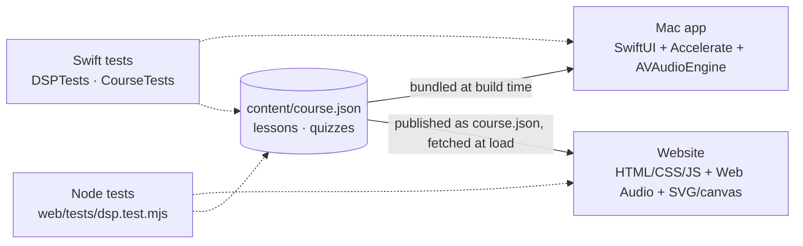
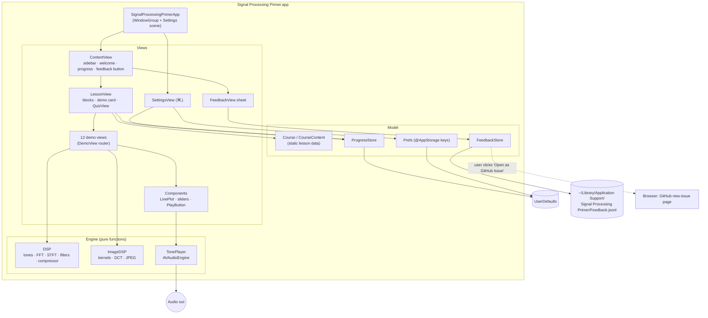
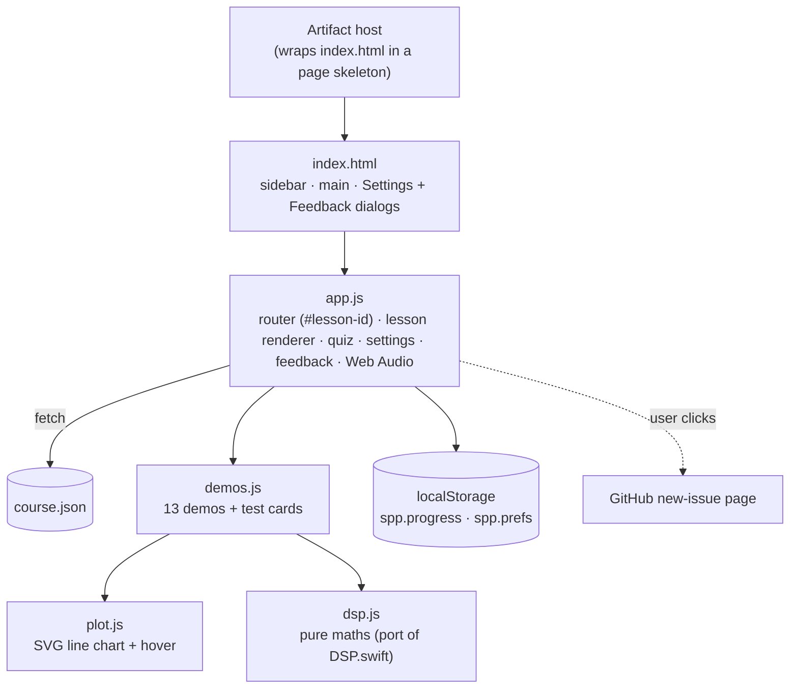

# System Design

Signal Processing Primer comes in two forms that share one content file, `content/course.json`:

- **The Mac app:** a single-window native macOS app (SwiftUI, macOS 14+). It has no server, no network calls and no third-party dependencies. `course.json` is bundled into the app at build time.
- **The website:** plain HTML, CSS and ES-module JavaScript in `web/`, published as a private claude.ai Artifact. It is a port of the Mac app: the same lessons, demos, quiz rules, settings and feedback, with the maths ported from Swift to `web/dsp.js` and checked by matching tests.

The sections below describe the Mac app first, then the website.

## Architecture

## Components

| Component | Job |
|---|---|
| `SignalProcessingPrimerApp` | Creates the main window and the standard `Settings` scene, which gives ⌘, and the app-menu item. Adds Help ▸ Send Feedback… (⇧⌘F). |
| `ContentView` | `NavigationSplitView` with the course sidebar (module sections, completion ticks, progress bar and a small Feedback button) and the detail pane. The toolbar gear opens Settings. Stops any sound when you switch lessons. |
| `LessonView` / `QuizView` | Renders a lesson's `Block`s in order: text with inline Markdown, headings, formula cards, bullets, *In practice* boxes and the demo card. Then the quiz, which scores your answers, shows explanations and records progress. |
| Demo views | One view per `DemoKind`. Each keeps its own `@State` parameters, calls the engine to compute plots and sounds, and redraws on every change. The heavy image work runs in a detached task. |
| `Components` | Shared building blocks: the validated colour palette, `ParamSlider`, `PlayButton`/`StopButton`, `Readout`, `DemoCard` and `LinePlot`. `LinePlot` is a Swift Charts line chart with a legend only when there are two or more series, explicit domains and a hover crosshair with a tooltip. |
| `DSP` | Pure 1-D maths on `[Float]`: tone and chirp generation, aliasing, quantisation and dither, SNR, windows, an FFT magnitude spectrum (Accelerate `vDSP.DiscreteFourierTransform`), STFT, dense and sparse convolution, RBJ biquads with frequency response, and a feed-forward compressor. |
| `ColourDSP` / `RGBImage` | Lesson 13's maths: four transfer functions (linear, sRGB, power 2.2, BT.1886 2.4), quantizing a linear-light ramp through each, counting codes in the shadows, BT.601 Y′CbCr conversion, 4:4:4/4:2:2/4:2:0 subsampling (block-average chroma, then replicate), channel views and RGB PSNR. Also draws a colour test card with bars, a hue sweep, red text on blue, 1-px red/green stripes and a skin-tone patch. |
| `WhiteBalance` | The light's colour at a temperature and tint: the Planckian locus (Kim et al. cubic fit), offset along its normal in CIE 1960 uv by the tint (±100 = Duv ∓0.02, negative = green as in Lightroom), → XYZ → linear sRGB, normalised so 6,500 K / tint 0 is neutral. Capture multiplies linear reflectance by the light, with exposure set so no channel clips. Camera correction applies per-channel gains relative to green. Also gray-world and eyedropper estimates, temperature-and-tint fitting (a coarse grid, then refined), and a 6×4 colour-checker chart with a neutral bottom row. |
| `ImageDSP` / `GrayImage` | Pure 2-D maths: a procedural test card, 2-D convolution kernels (blur, sharpen, Sobel, emboss), an orthonormal 8×8 DCT/IDCT, JPEG quantisation tables scaled like libjpeg, a JPEG round trip with zero-coefficient share and PSNR, and CGImage conversion. |
| `TonePlayer` | One shared `AVAudioEngine` and player node. It plays a mono buffer at 44.1 kHz with 10 ms fades and stops the previous sound first. |
| `ProgressStore` | Completed lessons, best quiz scores and the last-visited lesson, saved as JSON in `UserDefaults`. |
| `Prefs` | The six preference keys and their defaults. Views bind to them with `@AppStorage`. |
| `FeedbackStore` | Appends feedback as JSON lines to a local file and builds a pre-filled GitHub issue URL. |

## Main flows

1. **Learning a lesson.** The user picks a lesson in the sidebar, which updates `selection`. `ContentView` records the visit and stops audio. `LessonView` renders the blocks and puts the demo where `.demo` appears.
2. **Using a demo.** The user moves a slider, which changes `@State`. The SwiftUI body recomputes and the engine function runs synchronously. Audio maths takes milliseconds; the image demos use `.task(id:)` with a detached task. The chart redraws. **Play** generates a buffer of the length set in Settings and hands it to `TonePlayer`.
3. **Taking a quiz.** The user picks answers and clicks **Check Answers**. The quiz scores them and calls `ProgressStore.recordQuiz`. If the score meets the pass mark, the lesson is added to `completed`, which saves it and updates the sidebar tick and progress bar.
4. **Feedback.** The user clicks Feedback or presses ⇧⌘F. A sheet opens, labelled with the current lesson. **Save** appends a line to the local file. **Open as GitHub Issue** also saves, then opens the browser so the user can review and submit.
5. **Settings.** Pressing ⌘, opens the Settings window. Changes to `@AppStorage` take effect live: text size reflows lessons, volume applies to the next sound, and a custom image reloads the picture demos.

## Where data lives

| Data | Location |
|---|---|
| Course text and quizzes | `content/course.json`, bundled into the app and loaded by `CourseContent.swift` |
| Preferences | `UserDefaults` (domain `com.amalmehta.SignalProcessingPrimer`) |
| Progress | `UserDefaults`, key `progress.v1`, JSON |
| Feedback | `~/Library/Application Support/Signal Processing Primer/Feedback.jsonl` |
| Custom demo image | Only its path is stored. The image is read on demand, converted to grayscale and scaled to 360 px or less. |

Nothing leaves the Mac unless you click **Open as GitHub Issue** and submit the issue yourself.

## Key decisions and trade-offs

- **Native SwiftUI rather than web content in a shell.** It feels like a real Mac app, gets fast vDSP maths and gives low-latency audio. The cost is that the later website will be a separate build (see Known limits).
- **One JSON content file for both versions.** Editing `content/course.json` updates the Mac app and the website together, so they can't drift apart. The trade-off is losing compile-time checks, so `CourseTests` (Swift) and the Node test both check every lesson: valid answer indices, exactly one demo, an *In practice* box and unique ids. In the Mac app, a malformed file fails an assertion in Debug builds and leaves the course empty in Release.
- **Pure engine functions.** All maths is in stateless functions on plain arrays. That makes it easy to unit-test and to reuse in a future website port, at the cost of recomputing on every redraw. This is fine at these sizes: FFTs of 4,096 points or fewer, about 2 s of audio, images of 360 px or less.
- **Compute in the view body for audio demos.** It keeps the code simple, and the results come back in well under a frame on modern Macs. Image filtering and JPEG are slower (up to about 0.3 s in Debug builds), so they run in a detached task.
- **Generated test material.** Tones, drum loops, chirps and the test card are all synthesised, so there are no licensing questions and the repo stays small. Users can still load their own photo.
- **Quiz pass mark is relative.** "All but one correct" (default) or "All correct" works for any quiz length; Lesson 13 has 4 questions. The stored values (2 and 3) are unchanged from v1, so existing settings carry over.
- **Grayscale images for Lessons 10–11, colour for Lesson 13.** Filtering and JPEG work on luminance only, so those lessons stay about spatial frequency. Lesson 13 handles colour separately: gamma is shown as stored ramps, not on a photo, so the banding is unambiguous. Chroma subsampling uses a test card built to expose it, or your own photo in colour.
- **Echoes by sparse convolution.** A 400 ms echo would be a 17,640-tap kernel. `sparseConvolve` applies only the non-zero taps, and a test checks it matches dense convolution exactly.
- **Charts follow the dataviz rules.** There is one fixed categorical pair: blue for the processed or main signal, orange for the original or reference. The reference is dashed, so colour is never the only cue. There are no dual axes, legends appear only for two or more series, and every chart has a hover read-out. The spectrogram uses a single-hue sequential blue ramp with separate light and dark steps.
- **Local-only feedback.** Feedback is never sent anywhere automatically, so it needs no accounts or keys. Reaching the developer needs one extra click to the GitHub issue page.
- **Unsandboxed, ad-hoc signed.** This keeps local builds and file picking simple. Distributing the app would need signing, the App Sandbox (read access to user-selected files) and notarisation.

## How it's tested

- `TintTests` (2) check that tint moves the light towards green or magenta, and that the matching camera tint neutralises it while the eyedropper recovers both temperature and tint.
- `WhiteBalanceTests` (4) check that the light is neutral at 6,500 K, warm below and cool above; that the matching camera preset and the eyedropper make the gray patch neutral; that the eyedropper's estimate recovers the true light within 100 K; and that gray world is exact on a colourless scene.
- `ColourTests` (4) check that every transfer function inverts exactly, that the lesson's numbers hold (26 vs 90 codes for the darkest 10% at 8 bits), Y′CbCr round trips, and that 4:2:0 keeps luma exactly while losing chroma detail.
- `DSPTests` (16) check the maths against known answers:
  - alias folding
  - FFT bin and amplitude
  - leakage reduction from a Hann window
  - about 6 dB per bit of quantisation SNR
  - convolution against its definition, and sparse against dense convolution
  - the −3 dB point and −40 dB/decade roll-off of a biquad low-pass
  - peak-EQ gain, a high-pass removing a 100 Hz tone
  - the compressor's static curve (it matches the quiz answer) and its gain reduction
  - DCT round trip and the DC-only case
  - JPEG: lower quality gives more zeros and lower PSNR
  - blur leaves flat regions unchanged, and Sobel finds edges
  - a spectrogram of a chirp rises over time
- `CourseTests` (6) check the course shape (4 modules, 13 lessons), every lesson's integrity, unique ids with every demo used exactly once, the navigation helpers, `ProgressStore` persistence and pass mark (using an isolated `UserDefaults` suite), and the feedback file and issue URL.
- **Visual check:** `scripts/screenshots.sh` opens each lesson at its demo and captures it. All 13 demos, Settings and the Feedback sheet were reviewed this way.
- **Website:** `web/tests/dsp.test.mjs` (21 Node tests) mirrors `DSPTests` and also checks that `course.json` is well formed. The site was checked in a browser:
  - all 13 lessons render with no console errors
  - no page overflows sideways at 375 px
  - light and dark themes both work
  - quiz pass and fail paths work, and progress is saved
  - the Settings dialog opens, and the feedback issue link is built correctly

## Website

| Component | Job |
|---|---|
| `index.html` / `styles.css` | Page structure and the visual system. Colour tokens are defined for light and dark (`prefers-color-scheme` plus the host's `data-theme`) and use the same blue/orange series pair and sequential blue ramp as the Mac app. Demos sit on a faint oscilloscope-graticule background. Below 860 px wide, the sidebar becomes a slide-in drawer. |
| `app.js` | Loads `course.json` and routes on `location.hash` (a plain lesson id, which the host allows). It renders blocks, using a minimal inline-Markdown renderer that escapes HTML first. It runs the quiz with the same pass-mark rule as the Mac app, and handles progress, settings, the feedback dialog, keyboard shortcuts (⌘, and ⇧⌘F) and audio. Audio uses one `AudioContext`, created on the first click, playing 44.1 kHz buffers with 10 ms fades. |
| `demos.js` | One `build(host, ctx)` function per demo. Each builds its controls with a tiny DOM kit and redraws on input. It returns a clean-up function when it holds listeners or an animation loop: the wheel's `requestAnimationFrame`, and the spectrogram's theme observers. |
| `plot.js` | An SVG line chart: nice ticks, optional log x, dashed reference series, dots, a legend only for two or more series, and a hover crosshair with a tooltip. It redraws on resize through `ResizeObserver`, and its colours are CSS variables, so it follows the theme. |
| `dsp.js` | A line-for-line port of the Swift maths. It uses an iterative radix-2 FFT instead of vDSP, and seeded mulberry32 noise instead of the Swift LCG, so noise samples differ between the versions while everything else is numerically equivalent. |

**Website decisions and trade-offs**
- **No framework and no build step.** The files are what gets published, so there's no bundler or toolchain to maintain. The cost is hand-rolled DOM code in `demos.js` and `app.js`.
- **Per-browser storage for progress and settings.** Each learner's progress stays in their own browser with no accounts. Every read and write is wrapped in try/catch, so the page still works when storage is blocked. Progress doesn't follow a learner across devices.
- **Your photo is kept for the tab only.** It isn't persisted to storage, which avoids size limits and keeps private photos out of storage.
- **Feedback opens a pre-filled GitHub issue**, the same as the Mac app, plus a *Copy text* fallback for visitors who can't reach the private repo.
- **Local preview needs a wrapper.** The page has no doctype or head of its own, because the host adds them. `scripts/serve_web.py` adds the same wrapper so local runs match production.

## Known limits

- **Website:** progress isn't synced between browsers or with the Mac app. Visitors without repo access can't file GitHub issues. The heavy image demos run on the main thread, so the page pauses briefly on slow phones.
- **Colour demo scope.** Lesson 13 doesn't cover colour spaces or gamuts (Rec.709 vs P3 vs Rec.2020) or HDR transfer functions. Those are mentioned in the text only. White balance models lights as black bodies shifted by a tint, so the spiky spectra of real fluorescent and LED lights (and the colour shifts they cause in particular objects) aren't simulated, and gains are a simple per-channel (von Kries-style) scaling in camera RGB, not a full chromatic-adaptation transform such as Bradford.
- **Recomputation.** Audio demos recompute synchronously on every slider movement. They're fine at current sizes but would need debouncing for longer signals.
- **No live input.** There is no microphone or camera input (you chose demos without it).
- **Two non-standard visual choices:**
  - The frame-rate wheel's motion blur is drawn by overlapping sub-frames. That's a visual approximation, not a physically exact exposure integral.
  - The screen refresh (usually 60 Hz) also samples the animation, so at some settings what you see is aliased a second time.
- **Content review.** The course has not been reviewed by a second domain expert. Use the feedback tab to report mistakes.
- **Distribution.** The app is not notarised, so other Macs will show a Gatekeeper warning.
